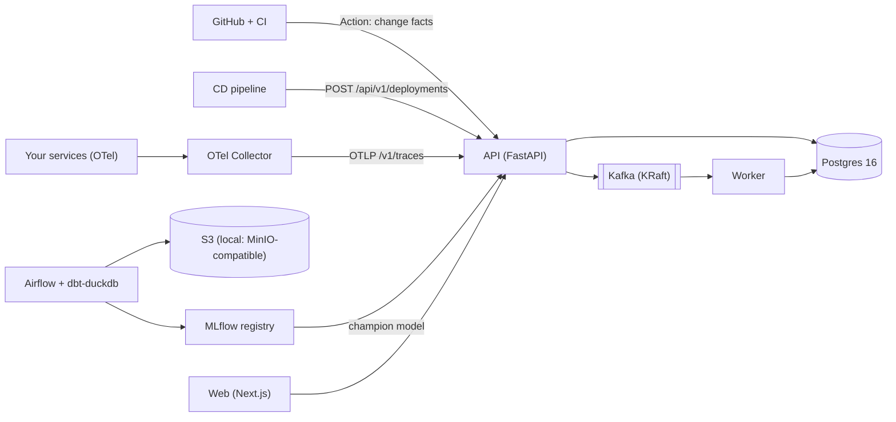

# ReleaseLens

**Release intelligence for engineering teams.** ReleaseLens answers two questions:

1. **Before deploy:** *Based on historical delivery data, how risky does this change look, and why?*
   A model trained on real historical CI builds scores **CI/build-failure risk** (0–100) and
   explains the score with SHAP.
2. **After deploy:** *Did this deployment introduce a regression, where did it probably
   originate, and which services were affected?* It compares OpenTelemetry traces before and after
   the release with statistical gating, builds the service graph from real traces, names the
   **probable origin**, and computes the **blast radius**.

Product loop: **PREDICT → DEPLOY → OBSERVE → DETECT → EXPLAIN → LEARN**.
ReleaseLens never deploys code. It plugs into your existing GitHub / CI/CD through a GitHub App
and Action, a deployment-event API, and an OTLP endpoint.

> **Status:** all milestones (M0–M12) are built and verified locally. See
> [`docs/DONE.md`](docs/DONE.md) for what exists, the evidence and the limits,
> [`docs/PLAN.md`](docs/PLAN.md) for the status board and [`docs/PROGRESS.md`](docs/PROGRESS.md)
> for the commands that were run. Every number in this README comes from a recorded run.
> External integrations (GitHub App, Stripe, Slack, OAuth) need owner credentials and run in
> fixture or test mode until then ([`docs/BLOCKERS.md`](docs/BLOCKERS.md)).

## Quick start (local, ₹0)

Requirements: Docker (Colima or Docker Desktop), `uv` ≥ 0.12, Node 22+ with `pnpm`, GNU Make.

```bash
make install        # Python workspace (uv) + web deps (pnpm)
make up-core        # postgres, kafka (KRaft), api, worker, web — waits until healthy
make smoke          # probe health endpoints
open http://localhost:23000/status
```

| Service | URL |
|---|---|
| Web app | http://localhost:23000 |
| API (OpenAPI docs) | http://localhost:28000/docs |
| Worker health | http://localhost:28001/readyz |

Host ports sit in a `2xxxx` block to avoid clashing with other local stacks
(see [`docs/dev/CONVENTIONS.md`](docs/dev/CONVENTIONS.md)).

## Architecture



Full diagrams, component responsibilities and data flows are in
[`docs/ARCHITECTURE.md`](docs/ARCHITECTURE.md). Every major choice has an ADR in
[`docs/DECISIONS.md`](docs/DECISIONS.md).

## Data and methodology (honest version)

- **Training data:** TravisTorrent build data re-published by its authors on Figshare
  (CC BY 4.0). We train on the `travistorrent_5_3_2016` release, **Java subset: 128,819 builds
  across 402 projects (2011-06 → 2015-08)**, measured after an md5-verified download. A later
  re-publication (`final-2017-01-25`, 200,561 Java builds) was profiled and rejected for training
  because its change-size columns are effectively empty: source churn is 0 on 99.08% of builds and
  test churn on 100%. See [`docs/data/DATASET_AUDIT.md`](docs/data/DATASET_AUDIT.md), ADR-0004 and
  ADR-0017.
- **What the model predicts:** the risk that a **CI build fails** (failed or errored), using only
  information available *before* the build starts. It does **not** predict production outages.
  The current build's CI result and duration are shown *next to* the score, never inside it.
- **Leakage controls:** a past build counts as history only if it **finished before** the current
  build started (finish time is conservatively upper-bounded). This is enforced by property tests
  against a naive oracle and by offline/online parity tests.
- **Model (champion `release_risk_ci/3`, XGBoost; test split = most recent 15%, evaluated once):**
  PR-AUC **0.811** (base rate 0.279), ROC-AUC **0.881**, Brier 0.109; calibration gate passed
  (ECE 0.0155), so a probability is shown. Held-out projects: PR-AUC 0.825. **Honest caveat:**
  most of the signal is build-failure persistence. After a *passing* build, PR-AUC is 0.320
  (base rate 0.122). Day-one tenants get a no-history model (test PR-AUC 0.537, no probability).
  See [`docs/ml/RESULTS.md`](docs/ml/RESULTS.md) and [`docs/ml/MODEL_CARD.md`](docs/ml/MODEL_CARD.md).
- **Live demo (measured, three scenarios):**
  - **payment v1→v2** (injected +250 ms and ~3.5% errors): REGRESSED, probable origin
    **payment** (HIGH confidence). Self-time p95 rose from 104 to 352 ms. Blast radius: orders
    and gateway affected, fraud healthy.
  - **fraud v1→v2:** REGRESSED HIGH, probable origin **fraud** (HIGH confidence, score 10 vs 2).
    Payment's latency rose too, but it was correctly not blamed.
  - **Control, payment v1→v1:** HEALTHY in all three looks.
  - See [`docs/demo/DEMO_SCRIPT.md`](docs/demo/DEMO_SCRIPT.md).
- **Regression detection:** a metric is flagged only if every gate passes (sample size, relative
  and absolute deltas, and a seeded bootstrap CI or a z-test). Severity is a documented
  deterministic score, **not a probability**. The tool reports a **probable** origin, never a
  "root cause".

## Security and tenancy

- Every tenant-owned row carries `tenant_id`. Repositories refuse calls without a tenant
  context, and Postgres **row-level security** filters every tenant-scoped transaction as a
  second guard (ADR-0010, ADR-0023).
- A route-enumerating cross-tenant and RBAC test matrix fails if a new route is not covered.
- API keys are stored as SHA-256 hashes (`rlk_<prefix>_<secret>`). Browser sessions are opaque
  and DB-backed, with CSRF protection.
- Postgres token-bucket rate limits apply per IP (auth) and per key (deployment events, risk,
  OTLP).
- Slack webhook URLs are encrypted at rest (AES-GCM).
- CI runs gitleaks, Trivy, pip-audit, bandit and pnpm audit on every push.
  [`docs/security/AUTH.md`](docs/security/AUTH.md) has the details.

## Repository layout

```
apps/web/              Next.js app (marketing + dashboard)
services/api/          FastAPI: REST API, auth, ingest, risk inference, webhooks
services/worker/       Kafka consumers, Postgres job runner, outbox relay
packages/rl_core/      Pure domain logic: features, stats, regression engine, graph, triage
packages/rl_db/        SQLAlchemy models, tenant-scoped repositories, Alembic migrations
data/pipeline/         Historical pipeline tasks (download → validate → Parquet → S3)
data/airflow/          Airflow DAGs wiring the pipeline tasks
demo/                  Five instrumented demo services, k6 traffic, scripted scenarios
infra/                 Compose stack, OTel Collector config, Kafka topic bootstrap
docs/                  Plan, progress, ADRs, architecture, data & ML docs
```

## Testing

```bash
make check             # ruff + bandit + mypy + unit tests
make test-integration  # testcontainers: Postgres 16, Kafka 4.3 (KRaft), S3
make web-check         # eslint + tsc + vitest
```

CI runs on every push: backend, frontend, data quality, and security (gitleaks, Trivy,
pip-audit, bandit, pnpm audit). Third-party actions are pinned by commit SHA.

## Benchmarks

Measured on a laptop VM: Colima, **2 vCPU / 4 GiB**, on an Apple M4. Each benchmark used the
default per-key rate limits, with nothing else running in the VM. Method and raw numbers:
[`docs/benchmarks/README.md`](docs/benchmarks/README.md).

| What | Result |
|---|---|
| Risk inference `POST /api/v1/risk/assessments` (features, XGBoost, SHAP), 8 req/s | p50 **22 ms**, p95 **40 ms**, 0 failures in 481 |
| Deployment event `POST /api/v1/deployments`, 10 req/s | p50 **19 ms**, p95 **30 ms**, 0 failures in 601 |
| OTLP ingest `POST /v1/traces`, 4,000 spans/s for 20 s | p95 **14.6 ms**. All 80,100 spans persisted, at about 3.7–4.7k spans/s, within ~5 s of the last request. The ceiling was not reached. |
| Deploy to first verdict (live demo) | REGRESSED with probable origin about **6.3 min** after the deploy: the 5-min early look plus 77 s of compute |
| Historical pipeline | ingest DAG 23 s cold / 5 s repeat; dbt build ≈ 10 s; model training 383 s |

## Known limitations

- The risk model and the change-fact extractor are **Java-only**. A repository without Java
  source gets its size facts reported as unknown, and its score is of limited use. This was
  seen live on this Python repository.
- External services (GitHub App, Stripe, Slack, GitHub OAuth) are exercised with signed
  fixtures and mocks only. The Playwright end-to-end suite is written but has not been run
  here, because no browsers are installed. The accessibility check was automated (axe-core: 0
  violations on 25 pages, [`docs/web/ACCESSIBILITY.md`](docs/web/ACCESSIBILITY.md)), not a
  manual audit.

- TravisTorrent is historical (2012–2016 Travis CI, open source). CI failure is **not** the same
  as a production regression, and transfer to a 2026 team's pipeline is evaluated (cross-project,
  cold-start) but not guaranteed.
- The demo topology has five services. Spans are stored in Postgres, which is adequate at demo
  scale (ADR-0008 sets the thresholds for revisiting that choice).
- The local S3 server is `pgsty/silo`, a MinIO-compatible fork, because upstream MinIO images
  are no longer distributed (ADR-0009).

## Attribution

Historical CI data: Moritz Beller, Georgios Gousios, Andy Zaidman, *TravisTorrent: Synthesizing
Travis CI and GitHub for Full-Stack Research on Continuous Integration*, MSR 2017,
DOI [10.1109/MSR.2017.24](https://doi.org/10.1109/MSR.2017.24). Data re-published under
CC BY 4.0, DOI [10.6084/m9.figshare.19314170](https://doi.org/10.6084/m9.figshare.19314170).
