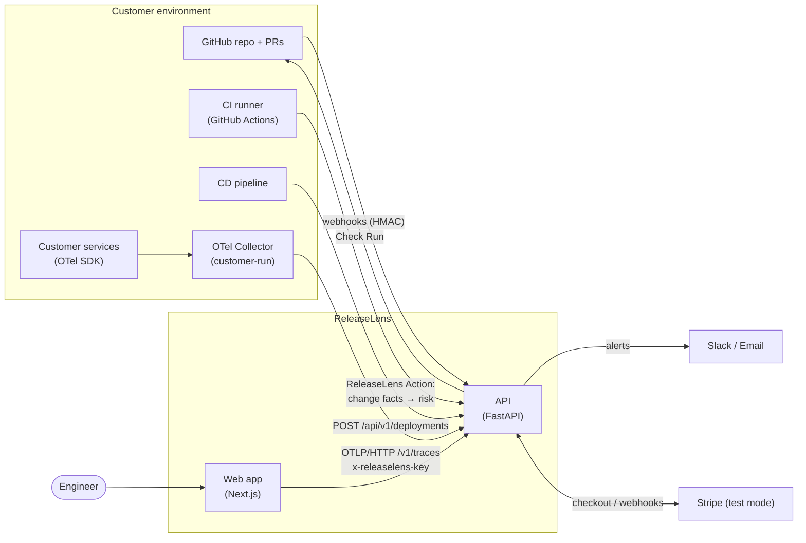
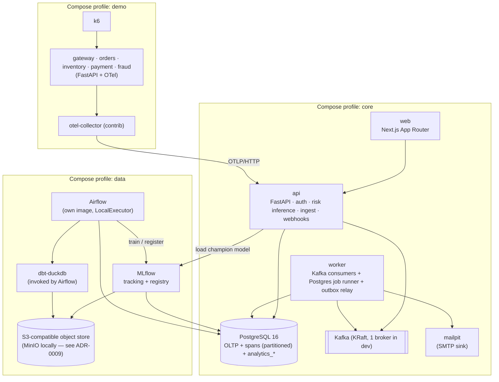
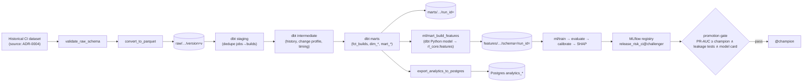
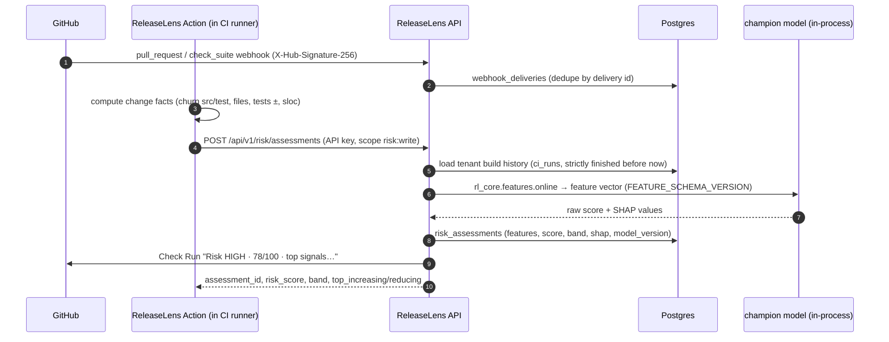
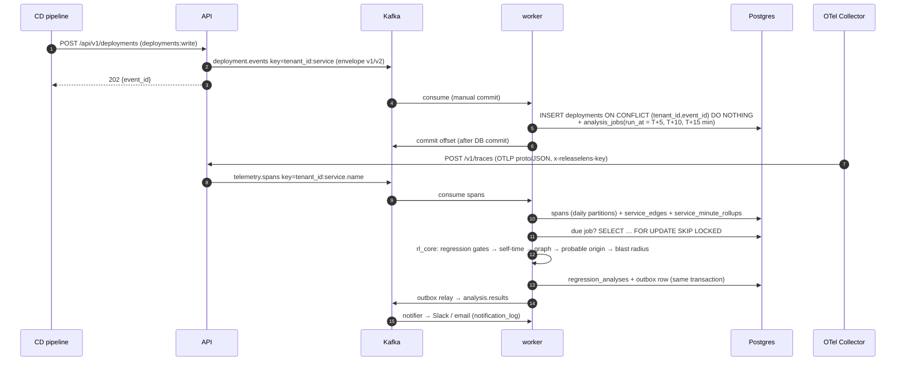
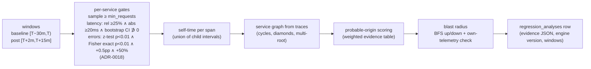
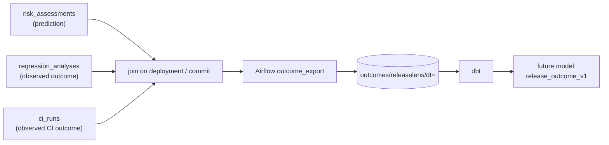

# ReleaseLens — Architecture

> Status: **M0 draft, pending approval.** No application code exists yet. This doc describes the
> target system; every component section names the milestone that builds it. Numbers marked
> `TBD — measured in Mx` are deliberately empty until measured.

Product loop: **PREDICT → DEPLOY → OBSERVE → DETECT → EXPLAIN → LEARN**

ReleaseLens never deploys code. It plugs into the customer's existing GitHub / CI/CD through
(1) a GitHub App + composite GitHub Action, (2) a deployment-event API, and (3) an OTLP
telemetry endpoint.

---

## 1. System context



## 2. Containers (runtime components)



### Component responsibilities

| Component | Owns | Does NOT own | Milestone |
|---|---|---|---|
| `apps/web` | Marketing site, docs (MDX), authenticated dashboard; typed client generated from the API's OpenAPI | Any business logic or direct DB access | M11 (skeleton M1) |
| `services/api` | REST API, auth/RBAC, API keys, tenant resolution, risk inference (champion model + SHAP), deployment-event intake → Kafka, OTLP ingest → Kafka, GitHub + Stripe webhooks, outbox writes | Long-running analysis, consuming Kafka | M1, M5, M6, M7, M10 |
| `services/worker` | Kafka consumers (deployments, spans, analysis results → notifications), Postgres job runner (`FOR UPDATE SKIP LOCKED`), outbox relay, retention jobs | HTTP endpoints (only a health endpoint) | M6–M10 |
| `packages/rl_core` | **Single source of truth**: domain models, event schemas, feature definitions (`FEATURE_SCHEMA_VERSION`), regression engine, self-time, service graph, triage/origin scoring, blast radius, severity | I/O (no DB/Kafka/HTTP clients) — pure functions + typed models | M2 onward |
| `ml/` | Training, evaluation, calibration, SHAP, model card, MLflow logging + registration | Serving (API loads the model) | M4 |
| `data/airflow` | DAG orchestration of the historical + outcome-export pipelines | Transform logic (lives in dbt / rl_core) | M2–M4 |
| `data/dbt` | staging → intermediate → marts → ml models and their tests | Feature formulas (calls `rl_core`, see ADR-0006) | M3–M4 |
| `data/analysis` | Reproducible statistical analysis → `FINDINGS.md` + JSON | — | M3 |
| `demo/` | Five instrumented services with a deterministic, env-controlled regression; k6 traffic; scripted scenarios | — | M7–M9 |
| `integrations/github-action` | Composite Action that computes repo-local change facts in the runner and calls the API | — | M5 |
| `infra/` | Compose files + profiles, OTel Collector configs, Kafka topic bootstrap | — | M1 |

## 3. Offline / historical path (M2–M4)



Every task is idempotent: object paths are keyed by dataset version / `run_id`, Postgres exports
use `INSERT … ON CONFLICT` or swap-table loads, and data-quality gates fail the DAG.

## 4. Live pre-deployment path (M5)



CI pass/fail and CI duration-vs-normal are displayed **next to** the risk score as separate
signals, never as model inputs (they are, or leak, the label).

## 5. Live post-deployment path (M6–M9)



### Kafka topics

| Topic | Key | Producer | Consumer(s) | Partitions / retention (dev) |
|---|---|---|---|---|
| `deployment.events` | `tenant_id:service` | api | worker (deployments) | set by bootstrap script — values in ADR-0007 |
| `telemetry.spans` | `tenant_id:service.name` | api (OTLP ingest) | worker (spans) | ″ |
| `analysis.results` | `tenant_id:deployment_id` | worker (outbox relay) | worker (notifier) | ″ |
| `*.dlq` | original key | consumers on permanent error | operator tooling | ″ |

Delivery semantics: at-least-once + idempotent persistence (`UNIQUE(tenant_id, event_id)`).
Transient errors → bounded exponential backoff with jitter, then partition pause/resume.
Permanent errors → DLQ with reason, stack, original topic/partition/offset.

**As built (M7/M8)** — details and limits in [`docs/events/TELEMETRY.md`](events/TELEMETRY.md):

* The API answers `/v1/traces` only after Kafka acknowledged every message (one per service per
  request, split above 768 KiB); rejected spans are reported through OTLP `partial_success`.
* The span consumer handles up to 100 messages per transaction; spans are idempotent on
  `(tenant_id, trace_id, span_id, start_time)`, and edges and minute rollups are derived only
  from the rows that transaction inserted. A per-tenant advisory lock makes edge counts exact
  when a parent and its child are stored by concurrent consumers.
* Day partitions are created by the worker's maintenance loop (today + 2 days, hourly) and, for
  any other day, by the consumer before its insert transaction; retention drops partitions
  (7 days) and deletes rollups (30 days).
* Analysis jobs: `early_5m` / `early_10m` analyse **as of** T+5 / T+10 even when they run late;
  `final` runs at T+15 on the full window. Window profiles are per environment (`demo`: baseline
  10 min, warm-up 1 min, post window to T+8). The handler writes `regression_analyses` and the
  `analysis.results` outbox row (`rl_core.events.analysis.AnalysisEnvelope`) in one transaction.
* `spans` has no foreign key to `organizations` (per-row cost on the hottest path); the consumer
  checks each batch's tenants once and dead-letters unknown ones.

## 6. Post-deployment intelligence (all in `rl_core`, M8–M9)



Wording rule: **"probable origin"**, never "root cause". Severity v1 is a deterministic score,
not a probability.

## 7. Feedback path (M4 monitoring, M10+)



## 8. Data stores

| Store | Holds | Tenancy |
|---|---|---|
| Postgres (app DB) | OLTP tables, spans (declaratively partitioned by day), edges, minute rollups, jobs, outbox, analytics_* | `tenant_id NOT NULL` on every tenant-owned table; composite indexes lead with `tenant_id`; optional RLS (ADR-0010) |
| Postgres (MLflow / Airflow metadata) | Separate **databases** on the same server in dev | n/a (internal) |
| Object store `releaselens-data` | raw/, marts/, features/, outcomes/, reports/ (Parquet/JSON) | historical data is not tenant data; `outcomes/` partitioned by tenant |
| Object store `releaselens-mlflow` | MLflow artifacts | n/a |
| Kafka | Event log, short retention | `tenant_id` in key **and** payload |

Proposed addition to the spec's table list (needed for online history features):
**`ci_runs`** (tenant_id, project_id, repo, commit_sha, branch, is_pr, started_at, finished_at,
status, duration_s, source) populated from `check_suite` / `workflow_run` webhooks and an
optional backfill on GitHub App installation.

## 9. `rl_core` module map (planned)

```
rl_core/
  tenancy.py          TenantContext (required by every repository function)
  events/             versioned envelopes (deployment.completed v1, v2), span models
  features/
    schema.py         FEATURE_SCHEMA_VERSION, feature list, FORBIDDEN_INPUTS
    history.py        strictly-finished-before history windows (pure, sorted per project)
    change.py         change-size / test / codebase features
    offline.py        vectorised (Polars) batch computation — used by the dbt Python model
    online.py         per-request computation — used by the API
  regression/         windows, percentile bootstrap, two-proportion z-test, gates, severity v1
  selftime.py         interval-union self-time
  graph.py            service graph + cycle-safe BFS/DFS
  triage.py           probable-origin scoring + reasoning text
  blast_radius.py
```

## 10. Cross-cutting concerns

- **Multi-tenancy:** API key or session → `TenantContext`; repositories refuse calls without it;
  Kafka keys/payloads carry `tenant_id`; cross-tenant tests are mandatory (M6, M10).
- **Idempotency:** `(tenant_id, event_id)` for deployment events, GitHub delivery IDs, Stripe
  event IDs, outbox row IDs.
- **Self-observability:** structured JSON logs with trace/span IDs from day one (M1);
  ReleaseLens' own services can emit OTel to the same collector in dev.
- **Security:** Argon2id, hashed API keys with visible prefix, CSRF for cookie auth, strict CORS,
  signature-verified webhooks, rate limits on auth + ingest, secrets only via env files.
- **Honesty guardrails:** "probable origin"; risk score 0–100 unless calibration justifies a
  probability; the CI-failure model is never described as an outage predictor.

## 11. Deployment topology & resource budget (dev machine)

Target dev machine: Apple M4, 10 cores, 16 GB RAM. Container engine: Colima. Per-profile memory
and disk figures: `TBD — measured in M1`. See `docs/PLAN.md` § Environment constraints.
