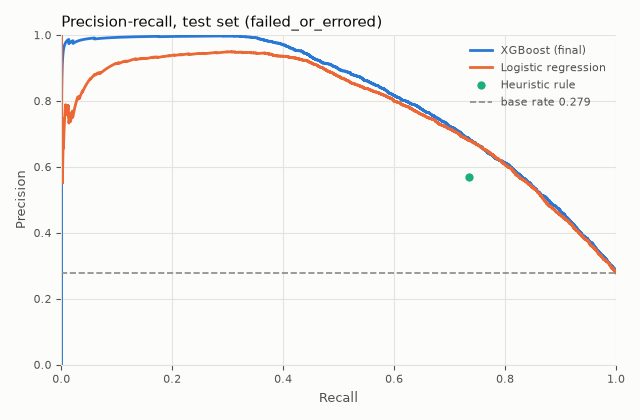
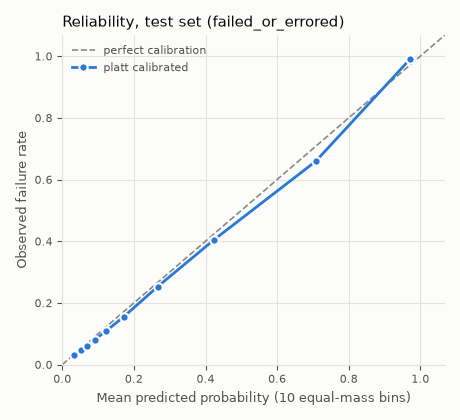
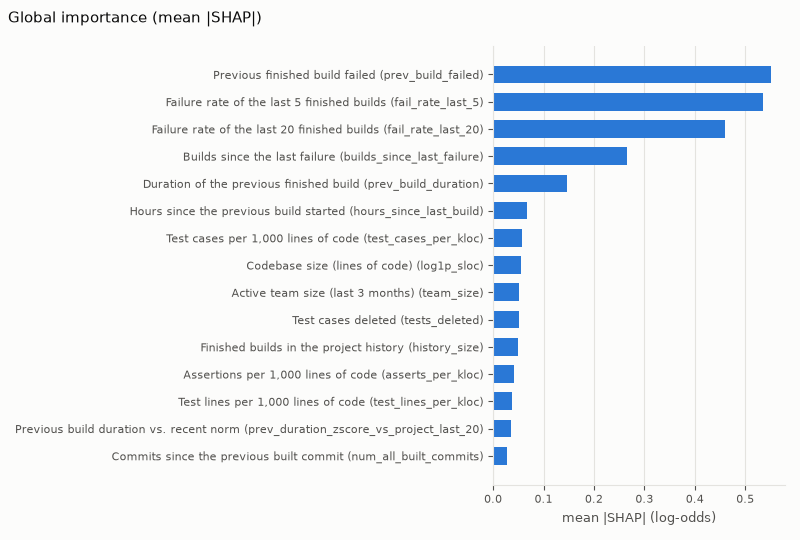

# ML results — CI-failure risk model (M4)

> Generated by `python -m rl_ml.card` from `docs/ml/results/*.json` (real runs only). Do not edit by hand: re-run training or the generator.

## Headline

- On the untouched chronological test set (19,293 builds, failure base rate 0.279), the final model (**XGBoost**, chosen by validation PR-AUC) reaches **PR-AUC 0.811** (95% project-bootstrap CI 0.660–0.904; 2.91× the base rate) and ROC-AUC 0.881: **strong** discrimination overall.
- Baselines on the same rows: heuristic rule (previous build failed OR churn > p90) PR-AUC 0.492; majority class 0.279.
- The top 10% highest-risk builds fail at 99.0% (lift 3.55× over the base rate).
- Much of the overall signal is **persistence** (a broken build tends to stay broken). After a passing build (72.5% of test builds, base rate 0.122) the model reaches PR-AUC 0.320 (2.61× base; heuristic 0.131) and ROC-AUC 0.743 (**moderate**); its top 10% of those builds fail at 38.2%: predicting *new* breakage is much harder.
- Without build history (cold start, history masked) PR-AUC is 0.480 (1.72× base) and ROC-AUC 0.724: **moderate**; a model trained without history features reaches PR-AUC 0.537 / ROC-AUC 0.712 (**moderate**).
- Calibrated probability exposed: **yes** (ADR-0012 gate, platt calibration).

## 1. Data, label and splits

- Label: label 1 = failed or errored, 0 = passed; canceled/started excluded (ADR-0005).
- Feature mart run_id `m3-run1`, FEATURE_SCHEMA_VERSION `1.0.0`, dataset md5 `4713d8b73b667a2c375b89c20f531fc0`.
- Mart file `part-00000.parquet`: 128,617 rows, sha256 `384f66b66bde7416957c189aeccd9f55e369bbb7d9acf726492371a1a25569a5`.
- Split: the mart's global chronological 70/15/15 split (cut dates below).

| split | builds | failures | base rate | projects | started_at range (UTC) |
|---|---|---|---|---|---|
| train | 90,031 | 26,152 | 0.290 | 373 | 2011-06-20 → 2015-01-10 |
| validation | 19,293 | 5,800 | 0.301 | 277 | 2015-01-10 → 2015-04-17 |
| test | 19,293 | 5,383 | 0.279 | 274 | 2015-04-17 → 2015-08-19 |
| all | 128,617 | 37,335 | 0.290 | 402 | 2011-06-20 → 2015-08-19 |
- Note: manifest verified (sha256 + rows).

## 2. Leakage audit

Every row satisfies `max_history_input_finished_at < started_at` (128,169 of 128,617 rows have history; violations: 0; smallest gap 1 s). Feature list ∩ FORBIDDEN_INPUTS = ∅. Also covered by `ml/tests/test_leakage.py`.

Features that are null for every training row are **dropped from all model inputs** (NULL by design in the mart, see `data/dbt/models/ml/mart_build_inputs.sql`):

| feature | why it is null |
|---|---|
| `num_commits_in_push` | no push-level commit count in the 2016 release |
| `description_complexity` | PR title/description tagged uncertain (text may postdate the build) |
| `project_age_days` | from repo_age_days; gh_first_commit_created_at is a copy of tr_started_at |

## 3. Candidates (validation)

| model | features | val PR-AUC | val ROC-AUC | key parameters | fit / search s |
|---|---|---|---|---|---|
| Majority class | 34 | 0.301 | 0.500 | — | 0.0 |
| Heuristic rule | 34 | 0.535 | 0.775 | total_churn_p90_train=408.000 | 0.0 |
| Logistic regression | 34 | 0.813 | 0.883 | C=0.010 | 0.5 |
| Random forest | 34 | 0.836 | 0.887 | min_samples_leaf=25 | 11.4 |
| XGBoost **(final)** | 34 | 0.840 | 0.889 | max_depth=7, learning_rate=0.015, n_estimators=522, min_child_weight=3.053, subsample=0.661, colsample_bytree=0.707 | 185.8 |
| XGBoost + time features | 36 | 0.840 | 0.889 | max_depth=5, learning_rate=0.046, n_estimators=232, min_child_weight=3.876, subsample=0.638, colsample_bytree=0.932 | 147.3 |

Time-of-week features (hour-of-week sin/cos): XGBoost val PR-AUC without 0.8397, with 0.8397 (Δ -0.0001, 30 Optuna trials each) → time features **not used**.
Final model: **XGBoost** — highest validation PR-AUC among Majority class, Heuristic rule, Logistic regression, Random forest, XGBoost; selection locked at 2026-10-13T04:43:54.592265+00:00 before the test set was opened.
Runner-up: Random forest (val PR-AUC 0.8361, margin 0.0036) — effectively a tie; the tree models are interchangeable here.

## 4. Test set (evaluated once)

Test-set evaluations in this run: **1** (guarded; access log: final evaluation of xgboost (selection locked 2026-10-13T04:43:54.592265+00:00)).

| metric | value |
|---|---|
| PR-AUC (average precision) | 0.811 (95% CI 0.660–0.904) |
| ROC-AUC | 0.881 (95% CI 0.833–0.920) |
| base rate | 0.279 |
| PR-AUC / base rate | 2.91 |
| precision @ top 10% | 0.990 |
| lift @ top 10% | 3.55 |
| threshold (max F1 on validation) = 0.6513 | precision 0.768, recall 0.656, F1 0.708, flags 23.8% of builds |
| confusion matrix | TP 3,530 · FP 1,065 · FN 1,853 · TN 12,845 |
| Brier score (selected calibrator) | 0.109 |

CIs resample whole projects (builds within a project are correlated).

All candidates on the same test rows — reference only, computed in the same single pass after the final model was locked; never used for selection:

| model | test PR-AUC | test ROC-AUC | lift @ top 10% |
|---|---|---|---|
| Majority class | 0.279 | 0.500 | 1.04 |
| Heuristic rule | 0.492 | 0.760 | 1.94 |
| Logistic regression | 0.773 | 0.875 | 3.39 |
| Random forest | 0.810 | 0.879 | 3.53 |
| XGBoost | 0.811 | 0.881 | 3.55 |
| XGBoost + time features | 0.812 | 0.881 | 3.54 |



## 5. Calibration and the probability gate (ADR-0012)

Both calibrators are fitted on validation only. The gate is applied to the method chosen on validation (5-fold CV Brier inside validation: isotonic 0.10695, platt 0.10672 → **platt**). Thresholds (ADR-0012, fixed before results): ECE ≤ 0.05, Brier skill > 0 (reference = the test set's own failure rate, the stricter choice), slope in [0.8, 1.2].

| method | ECE (10 equal-mass) | Brier skill | slope | intercept | gate |
|---|---|---|---|---|---|
| platt (selected on validation) | 0.0155 ✓ | 0.4594 ✓ | 1.022 ✓ | -0.086 | PASS |
| isotonic (informational) | 0.0158 ✓ | 0.4576 ✓ | 1.011 ✓ | -0.088 | PASS |

**Outcome: probability is EXPOSED.**

Reliability (selected method, test, 10 equal-mass bins):

| bin | mean predicted | observed rate | n |
|---|---|---|---|
| 1 | 0.034 | 0.032 | 1,930 |
| 2 | 0.052 | 0.049 | 1,930 |
| 3 | 0.069 | 0.059 | 1,930 |
| 4 | 0.091 | 0.081 | 1,929 |
| 5 | 0.122 | 0.109 | 1,929 |
| 6 | 0.171 | 0.154 | 1,929 |
| 7 | 0.267 | 0.253 | 1,929 |
| 8 | 0.423 | 0.404 | 1,929 |
| 9 | 0.707 | 0.659 | 1,929 |
| 10 | 0.971 | 0.990 | 1,929 |



## 6. Risk score and bands

`risk_score` = percentile of the raw score among validation predictions (1,001-point quantile table in the bundle metadata). Bands are cut on validation by recall targets; cut-points are stored in the model metadata (`risk_bundle/metadata.json`, MLflow model metadata and version tags).

| band | recall target (val) | raw cut | risk_score cut | validation precision / recall / flagged | test precision / recall / flagged |
|---|---|---|---|---|---|
| ≥ MEDIUM | 0.80 | 0.4368 | 64 | 0.659 / 0.800 / 36.5% | 0.610 / 0.802 / 36.7% |
| ≥ HIGH | 0.50 | 0.8974 | 84 | 0.946 / 0.500 / 15.9% | 0.945 / 0.438 / 12.9% |
| ≥ CRITICAL | 0.20 | 0.9890 | 94 | 0.995 / 0.200 / 6.0% | 0.989 / 0.051 / 1.4% |

| band (exclusive) | validation share / failure rate | test share / failure rate |
|---|---|---|
| LOW | 63.5% / 0.095 | 63.3% / 0.087 |
| MEDIUM | 20.6% / 0.438 | 23.8% / 0.427 |
| HIGH | 9.9% / 0.915 | 11.5% / 0.940 |
| CRITICAL | 6.0% / 0.995 | 1.4% / 0.989 |

## 7. Per-project performance

Projects with ≥ 30 test builds and both classes present: 121 of 274. Median per-project PR-AUC 0.296 (IQR 0.136–0.585); median PR-AUC / project base rate 1.76; 93.4% of projects above their own base rate. The full per-project list is in the results JSON.

## 8. Cross-project generalisation

80 of 402 projects held out (first 80 projects ranked by sha256('42:<project>')). XGBoost refit with the final hyper-parameters on the remaining projects' train rows (72,995), early-stopped on their validation rows; no re-tuning.

| evaluation set | builds | projects | base rate | PR-AUC | ROC-AUC | PR-AUC / base | heuristic PR-AUC |
|---|---|---|---|---|---|---|---|
| seen projects, test window (reference) | 16,079 | 221 | 0.271 | 0.807 | 0.880 | 2.97 | 0.483 |
| held-out projects, test window | 3,214 | 53 | 0.318 | 0.825 | 0.875 | 2.59 | 0.533 |
| held-out projects, all rows | 24,062 | 80 | 0.297 | 0.797 | 0.867 | 2.68 | 0.506 |

## 9. Cold start

Test rows with every history feature except `project_age_days` set to missing (`prev_build_failed`, `fail_rate_last_5`, `fail_rate_last_20`, `builds_since_last_failure`, `hours_since_last_build`, `prev_build_duration`, `prev_duration_zscore_vs_project_last_20`, `history_size`): PR-AUC 0.480 (vs 0.811 with history), ROC-AUC 0.724 (vs 0.881), PR-AUC / base rate 1.72. This estimates day-one performance for a tenant without build history in ReleaseLens.

Caveat: masking history on a model trained *with* history depends on how its trees route missing values, learned from the few training rows without history, so that number is fragile (it moves between near-equivalent models). A diagnostic model with the same family and hyper-parameters trained **without** history features (26 features, not a selection candidate) scores PR-AUC 0.537 / ROC-AUC 0.712 on the same test rows (masked final model: 0.480 / 0.724). A day-one tenant should be served by such a no-history model, not by masking.

## 9b. Persistence vs new breakage

Test rows split by the outcome of the previous *finished* build of the same project. The failure rate after a failed build is far higher than after a passing one, so a large part of the overall PR-AUC is "broken stays broken". The *previous passed* slice is the product-relevant question of predicting new breakage from the change itself.

| slice | builds | share | base rate | PR-AUC | ROC-AUC | PR-AUC / base | heuristic PR-AUC | logistic PR-AUC |
|---|---|---|---|---|---|---|---|---|
| previous finished build passed | 13,993 | 72.5% | 0.122 | 0.320 | 0.743 | 2.61 | 0.131 | 0.290 |
| previous finished build failed | 5,291 | 27.4% | 0.693 | 0.936 | 0.857 | 1.35 | 0.693 | 0.896 |
| no finished history yet | 9 | 0.0% | 0.444 | 0.710 | 0.700 | 1.60 | 0.556 | 0.950 |

## 10. Sensitivity: errored builds excluded (ADR-0005)

ADR-0005 sensitivity analysis: the same pipeline with `errored` builds removed from every split (history features unchanged). Base rates differ, so compare PR-AUC / base rate and ROC-AUC, not raw PR-AUC.

|  | failed or errored (primary) | errored excluded |
|---|---|---|
| test builds | 19,293 | 17,550 |
| test base rate | 0.279 | 0.207 |
| final model | XGBoost | XGBoost |
| val PR-AUC (final) | 0.840 | 0.764 |
| test PR-AUC | 0.811 | 0.783 |
| test PR-AUC / base rate | 2.91 | 3.78 |
| test ROC-AUC | 0.881 | 0.889 |
| test lift @ top 10% | 3.55 | 4.53 |
| heuristic rule test PR-AUC | 0.492 | 0.405 |
| cold-start test PR-AUC (history masked) | 0.480 | 0.472 |
| no-history model test PR-AUC | 0.537 | 0.537 |
| after a passing build: base rate | 0.122 | 0.082 |
| after a passing build: PR-AUC | 0.320 | 0.243 |
| after a passing build: ROC-AUC | 0.743 | 0.752 |
| held-out projects PR-AUC (test window) | 0.825 | 0.811 |
| probability exposed | yes | yes |

## 11. Explainability

Mean |SHAP| (shap.TreeExplainer, log-odds) on 5,000 validation rows. Attributions describe the model, not causes of failure.

| # | feature | name | mean \|SHAP\| |
|---|---|---|---|
| 1 | Previous finished build failed | `prev_build_failed` | 0.5513 |
| 2 | Failure rate of the last 5 finished builds | `fail_rate_last_5` | 0.5355 |
| 3 | Failure rate of the last 20 finished builds | `fail_rate_last_20` | 0.4601 |
| 4 | Builds since the last failure | `builds_since_last_failure` | 0.2646 |
| 5 | Duration of the previous finished build | `prev_build_duration` | 0.1470 |
| 6 | Hours since the previous build started | `hours_since_last_build` | 0.0681 |
| 7 | Test cases per 1,000 lines of code | `test_cases_per_kloc` | 0.0565 |
| 8 | Codebase size (lines of code) | `log1p_sloc` | 0.0553 |
| 9 | Active team size (last 3 months) | `team_size` | 0.0517 |
| 10 | Test cases deleted | `tests_deleted` | 0.0505 |
| 11 | Finished builds in the project history | `history_size` | 0.0487 |
| 12 | Assertions per 1,000 lines of code | `asserts_per_kloc` | 0.0412 |
| 13 | Test lines per 1,000 lines of code | `test_lines_per_kloc` | 0.0382 |
| 14 | Previous build duration vs. recent norm | `prev_duration_zscore_vs_project_last_20` | 0.0356 |
| 15 | Commits since the previous built commit | `num_all_built_commits` | 0.0281 |

Example local explanations (validation rows):

- highest score (risk_score 100, CRITICAL): ↑ Failure rate of the last 20 finished builds is in the top 10% of builds in the training data; Failure rate of the last 5 finished builds is in the top 15% of builds in the training data; Previous finished build failed: yes. ↓ Files touched is in the bottom 38% of builds in the training data; Total lines changed is in the bottom 48% of builds in the training data; Hours since the previous build started is in the bottom 45% of builds in the training data.
- median score (risk_score 50, LOW): ↑ Hours since the previous build started is in the top 9% of builds in the training data; Previous build duration vs. recent norm is in the bottom 49% of builds in the training data; Test lines per 1,000 lines of code is in the top 25% of builds in the training data. ↓ Previous finished build failed: no; Failure rate of the last 5 finished builds is in the bottom 49% of builds in the training data; Builds since the last failure is in the top 43% of builds in the training data.
- lowest score (risk_score 0, LOW): ↑ Other files touched is in the top 6% of builds in the training data; Documentation files touched is typical of builds in the training data; Pull-request build: no. ↓ Builds since the last failure is in the top 1% of builds in the training data; Failure rate of the last 20 finished builds is in the bottom 21% of builds in the training data; Previous finished build failed: no.



## 12. Run, timings, environment

MLflow run `90cc5a4312ee4cce82dc494f96d3b668`, registered as `release_risk_ci/3` (alias `challenger` at registration); promoted to **`champion`** (previous champion: none; leakage tests passed: yes).

Wall-clock seconds: load_and_audit 0.14, train_candidates 360.5, validation_artifacts 0.17, no_history_model 1.64, test_evaluation 6.89, cross_project 9.7, explanations 4.08, total 383.32.

Environment: python 3.12.11, platform macOS-26.3-arm64-arm-64bit, numpy 2.5.4, pandas 3.0.6, scikit_learn 1.9.1, xgboost 3.4.1, shap 0.53.0, optuna 5.0.0. Git `8750d965e668492e32601416dd71b0e1030cffd4`.

## 13. Reproduce

```bash
uv run python -m rl_ml.train --features-run-id m3-run1 --trials 30 --seed 42
uv run python -m rl_ml.train --features-run-id m3-run1 --trials 30 --seed 42 --errored-excluded
uv run python -m rl_ml.card
```
